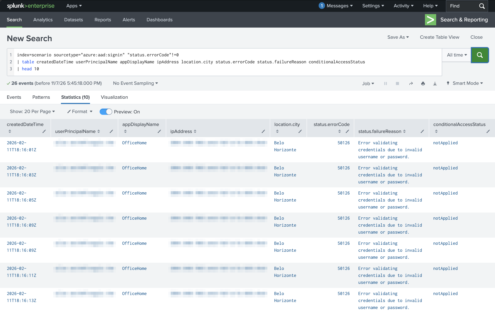
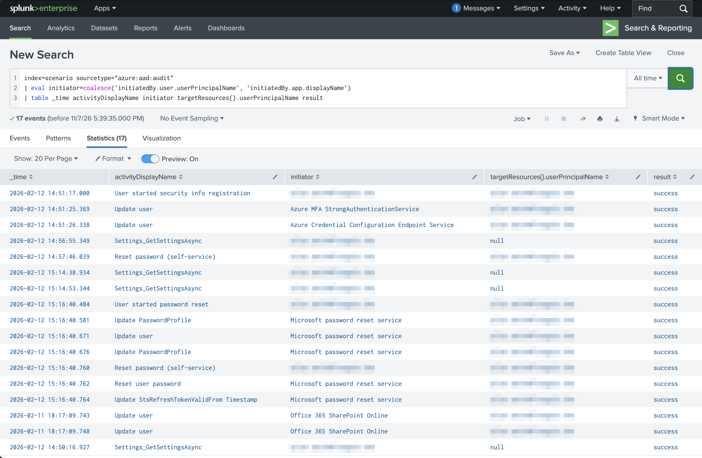

# 1. Concepts of Security, Compliance, and Identity (10–15%)

[← Back to README](README.md)

This domain is mostly vocabulary. The goal is to explain each term in one sentence.

---

### 1.1 Zero Trust

**Concept** — Never trust a request automatically, even from inside the network. Three principles:
**verify explicitly**, **use least-privilege access**, **assume breach**. Applied across six pillars:
identities, devices, applications, data, infrastructure, networks.

**Lab** — TryHackMe *M365 Monitoring Basics*: looked at how every sign-in is checked (user, device, location) rather than trusted by network location.

**Result**

**Why it works** — Each sign-in is checked on its own signals ("verify explicitly"). The logs exist because we assume something will eventually get through ("assume breach").

**Exam trap** — Zero Trust is a *strategy*, not a product. The third principle is "assume **breach**", not "assume trust".

---

### 1.2 Shared responsibility model

**Concept** — The cloud provider and the customer split security duties. The split depends on the service type.

| Service type | Microsoft secures | You secure |
| --- | --- | --- |
| SaaS (Microsoft 365) | Apps, OS, hosts, network, physical | Data, devices, accounts and identities |
| PaaS (Azure App Service) | OS, hosts, network, physical | Above + applications |
| IaaS (Azure VMs) | Hosts, network, physical | Above + operating system |
| On-premises | Nothing | Everything |

**Exam trap** — The customer is **always** responsible for information and data, devices, and accounts and identities, whatever the service type.

---

### 1.3 Defense in depth and the CIA triad

**Concept** — Defense in depth stacks layers, so one failed layer doesn't expose everything:
physical → identity and access → perimeter → network → compute → application → data.
The CIA triad: **confidentiality** (only the right people see it), **integrity** (it hasn't been changed),
**availability** (it's there when needed).

**Exam trap** — DDoS attacks target **availability**. Tampering targets **integrity**. Data leaks break **confidentiality**.

---

### 1.4 Encryption and hashing

**Concept**
- **Symmetric** encryption: one shared key for encrypting and decrypting.
- **Asymmetric** encryption: a public key encrypts, a private key decrypts.
- **Encryption at rest** (stored data) vs **in transit** (data moving over a network).
- **Hashing**: a one-way fingerprint, used to check integrity and store passwords. **Salting** adds random data before hashing.

**Exam trap** — Hashing **can't be reversed**. Encryption can, with the key.

---

### 1.5 Identity concepts

**Concept**
- **Authentication (AuthN)**: proving who you are.
- **Authorization (AuthZ)**: what you're allowed to do once signed in.
- **Identity provider (IdP)**: a service like Entra ID that handles sign-ins for many apps, using standards such as OAuth 2.0, OpenID Connect and SAML.
- **Single sign-on (SSO)**: one sign-in for many apps.
- **Federation**: trusting another organization's IdP.
- **Directory services**: Active Directory Domain Services (on-premises) vs Entra ID (cloud).

**Lab** — TryHackMe *M365 Monitoring Basics*: compared the sign-in result (AuthN) with the app and resource accessed (AuthZ) in the same log entry.

**Result**

**Exam trap** — AuthN always comes **before** AuthZ. Federation does **not** need the two organizations to share a directory.

---

### 1.6 Compliance concepts

**Concept**
- **Data residency**: where data is physically stored.
- **Data sovereignty**: data is subject to the laws of the country where it's stored.
- **Data privacy**: being open about how personal data is collected and used (e.g. GDPR).
- **GRC**: governance (rules), risk (finding and managing threats), compliance (proving you meet regulations).

**Exam trap** — Residency is about *location*. Sovereignty is about *which laws apply*.

---

## Self-check

- [ ] I can name the three Zero Trust principles
- [ ] I know what the customer always owns in the shared responsibility model
- [ ] I can match an attack to the part of the CIA triad it breaks
- [ ] I can explain hashing vs encryption
- [ ] I can explain authentication vs authorization
- [ ] I can explain data residency vs data sovereignty
