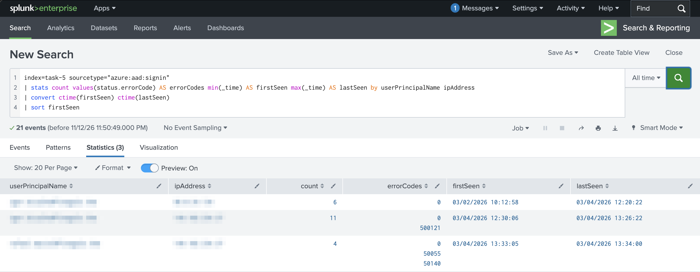
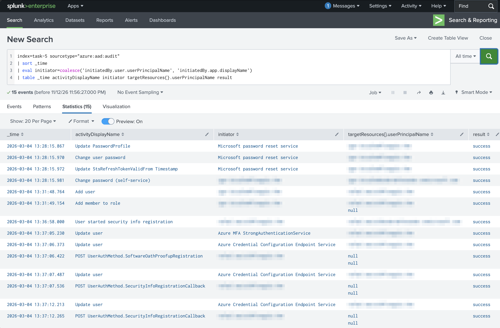

# 2. Capabilities of Microsoft Entra (25–30%)

[← Back to README](README.md)

Main lab: TryHackMe *Entra ID Monitoring*. Optional: an E5 trial tenant for portal screenshots.

---

### 2.1 Identity types

**Concept**
- **Users**: members (employees) and guests (B2B external users).
- **Workload identities**: service principals and managed identities, used by apps instead of people.
- **Devices**: Entra registered, Entra joined, or hybrid joined.
- **Agent identities** (added in the July 2026 objectives): identities for AI agents, managed like other identities.
- **Groups**: security groups and Microsoft 365 groups. Membership can be assigned or dynamic.
- **Hybrid identity**: Entra Connect / Cloud Sync syncs on-premises AD to Entra ID.

**Exam trap** — A **managed identity** is managed by Azure, so there are no credentials to store. A **service principal** is an app's identity, and you manage its secrets.

---

### 2.2 Authentication methods

**Concept**
- **MFA**: two or more of something you know, have, or are.
- **Passwordless**: Windows Hello for Business, FIDO2 keys and passkeys, Microsoft Authenticator.
- **SSPR**: self-service password reset.
- **Password protection**: blocks weak and banned passwords, including on-premises.
- **Security defaults**: free baseline MFA for everyone. Turn them off when you use Conditional Access.

**Lab** — TryHackMe *Entra ID Monitoring* (Task 4): followed one user's sign-ins in time order to spot an **MFA fatigue** attack.

**Query** (SPL, as run in the lab)

```spl
index=task-4 sourcetype="azure:aad:signin"
| sort _time
| table _time userPrincipalName ipAddress status.errorCode status.failureReason status.additionalDetails
```

**KQL equivalent** (Microsoft Sentinel)

```kql
SigninLogs
| sort by TimeGenerated asc
| project TimeGenerated, UserPrincipalName, IPAddress, ResultType, ResultDescription,
          AdditionalDetails = tostring(Status.additionalDetails)
```

**Result**


*User and IP addresses redacted. The screenshot shows the first 10 of 17 events.*

**Why it works** — Sorting by time shows the story:

| When | Source | Result |
| --- | --- | --- |
| Mar 2–4, 6 sign-ins | The user's usual IP | 0, success |
| Mar 4, 12:30 → 13:24 | A new IP | **500121** ×10, one MFA prompt about every 6 minutes, never completed |
| Mar 4, 13:26 | Same new IP | **0**, the user finally approves and the attacker is in |

There are no 50126 errors, so the attacker already had the correct password. MFA was the only thing in the way until the user gave in. That's MFA fatigue (also called MFA bombing or push spam).

**What stops it** — Number matching and location context in Microsoft Authenticator (the user must type a number shown on the sign-in screen), phishing-resistant MFA (FIDO2 keys, passkeys, Windows Hello), the "Report suspicious activity" option, and ID Protection risk policies.

**Exam trap** — SMS and voice calls are the **weakest** MFA methods. Microsoft recommends Authenticator, FIDO2 or Windows Hello.

---

### 2.3 Conditional Access

**Concept** — "If this, then that" policies. **Signals** (user or group, location, device, app, sign-in risk) lead to a **decision** (block, grant, or grant with conditions such as requiring MFA or a compliant device).

**Lab** — TryHackMe *Entra ID Monitoring* (Task 3): found the sign-ins that Conditional Access blocked, and which policy blocked them.

**Query** (SPL, as run in the lab)

```spl
index=task-3 sourcetype="azure:aad:signin" conditionalAccessStatus=failure
| table _time userPrincipalName ipAddress status.errorCode appliedConditionalAccessPolicies{}.displayName appliedConditionalAccessPolicies{}.result
```

**KQL equivalent** (Microsoft Sentinel)

```kql
SigninLogs
| where ConditionalAccessStatus == "failure"
| mv-expand ConditionalAccessPolicies
| project TimeGenerated, UserPrincipalName, IPAddress, ResultType,
          Policy = tostring(ConditionalAccessPolicies.displayName),
          PolicyResult = tostring(ConditionalAccessPolicies.result)
```

**Result**


*User and IP addresses redacted.*

**Why it works** — Every sign-in lists every Conditional Access policy and what it did. Error **53003** means "blocked by Conditional Access". The policy marked **failure** is the one that blocked the sign-in, here a location-based policy (**Block Suspicious Countries**). `notApplied` means the policy's conditions didn't match that sign-in. These blocked attempts happened *before* the high-risk detections in Lab 2.5b, so the location signal stopped the attacker first, and the risk-based MFA policy never came into play. A policy called "Allow Risky Users" is also worth reviewing in a real tenant.

**Exam trap** — Conditional Access runs **after** first-factor authentication. It needs **Entra ID P1**.

---

### 2.4 Roles

**Concept** — **Entra roles** (e.g. Global Administrator, User Administrator) manage Entra and Microsoft 365. **Azure RBAC roles** (Owner, Contributor, Reader) manage Azure resources.

**Exam trap** — These are two separate systems. Global Admin does **not** automatically get access to Azure resources.

---

### 2.5 Identity protection: detecting attacks

**Concept** — **Entra ID Protection** scores **user risk** (account probably compromised, e.g. leaked credentials) and **sign-in risk** (this sign-in looks suspicious, e.g. impossible travel or an anonymous IP), then applies risk-based policies.

**Lab** — TryHackMe *Entra ID Monitoring* (Task 2): grouped sign-ins by source IP to tell a password spray apart from normal failed logins.

**Query** (SPL, as run in the lab)

```spl
index=task-2 sourcetype="azure:aad:signin"
| stats count dc(userPrincipalName) AS users values(status.errorCode) AS errorCodes by ipAddress
| sort - count
```

**KQL equivalent** (Microsoft Sentinel)

```kql
SigninLogs
| summarize Attempts = count(), Users = dcount(UserPrincipalName), ErrorCodes = make_set(ResultType) by IPAddress
| sort by Attempts desc
```

**Result**


*IP addresses redacted.*

**Why it works** — `dc()` (`dcount()` in KQL) counts distinct accounts per IP. The top IP tried 7 different accounts in 14 attempts, and every attempt failed with 50126 (invalid username or password). A few tries per account across many accounts is a **password spray**: it stays under lockout limits. The other IPs each belong to one user with a normal mix: a typo (50126), the "stay signed in?" prompt (50140), then success (0).

**What stops it** — Entra password protection (bans common passwords), MFA, Smart Lockout, and ID Protection's password spray detection.

**Lab B** — TryHackMe *Entra ID Monitoring* (Task 3): reviewed what Entra ID Protection flagged during the attack.

**Query** (SPL, as run in the lab)

```spl
index=task-3 sourcetype="azure:aad:identity_protection:riskdetection"
| table _time userPrincipalName riskEventType riskLevel riskState detectionTimingType ipAddress
```

**KQL equivalent** (Microsoft Sentinel)

```kql
AADUserRiskEvents
| project TimeGenerated, UserPrincipalName, RiskEventType, RiskLevel, RiskState, DetectionTimingType, IpAddress
```

**Result**


*User and IP addresses redacted.*

**Why it works** — ID Protection raised four **anonymizedIPAddress** detections: sign-ins from an anonymous network such as Tor or an anonymizing VPN. Each is **high** risk, still **atRisk** (no one has fixed or dismissed it yet) and detected in **realtime**, during the sign-in itself. That makes them **sign-in risk** detections, which a risk-based Conditional Access policy can act on straight away, for example by requiring MFA or blocking. The room's separate `risky_user` data is the **user risk** side: the overall chance that the account itself is compromised.

**Lab C** — TryHackMe *Entra ID Monitoring* (Task 3): checked the overall risk on the account itself.

**Query** (SPL, as run in the lab)

```spl
index=task-3 sourcetype="azure:aad:identity_protection:risky_user"
| table userPrincipalName riskLevel riskState riskDetail riskLastUpdatedDateTime
```

**KQL equivalent** (Microsoft Sentinel)

```kql
AADRiskyUsers
| project UserPrincipalName, RiskLevel, RiskState, RiskDetail, RiskLastUpdatedDateTime
```

**Result**


*User redacted.*

**Why it works** — This is **user risk**: one row per account, not per sign-in. The four high-risk sign-in detections in Lab B rolled up into a **high** user risk, last updated a few minutes after them. `riskState = atRisk` with `riskDetail = none` means nobody has fixed it yet. An admin could dismiss it or confirm it compromised, or the user could clear it with a secure password change.

**What stops it** — A sign-in risk policy (high risk → block or require MFA) and a user risk policy (high risk → require a secure password change). Both need Entra ID P2.

**Exam trap** — Know user risk vs sign-in risk. ID Protection needs **Entra ID P2**.

---

### 2.6 Governance

**Concept**
- **PIM**: just-in-time, time-limited, approval-based admin roles.
- **Access reviews**: regular checks that people still need their access.
- **Entitlement management**: access packages that bundle groups, apps and SharePoint sites.
- **Lifecycle workflows**: joiner, mover and leaver automation.

**Lab** — TryHackMe *Entra ID Monitoring* (Task 5): followed the attacker from Task 4 after they got into the first account, using sign-in and audit logs together.

**Step 1: sign-ins by account and IP** (SPL)

```spl
index=task-5 sourcetype="azure:aad:signin"
| stats count values(status.errorCode) AS errorCodes min(_time) AS firstSeen max(_time) AS lastSeen by userPrincipalName ipAddress
| convert ctime(firstSeen) ctime(lastSeen)
| sort firstSeen
```



**Step 2: audit log timeline** (SPL)

```spl
index=task-5 sourcetype="azure:aad:audit"
| sort _time
| eval initiator=coalesce('initiatedBy.user.userPrincipalName', 'initiatedBy.app.displayName')
| table _time activityDisplayName initiator targetResources{}.userPrincipalName result
```



*User names, IP addresses and tenant domain redacted.*

**KQL equivalents** (Microsoft Sentinel)

```kql
SigninLogs
| summarize Count = count(), ErrorCodes = make_set(ResultType), FirstSeen = min(TimeGenerated), LastSeen = max(TimeGenerated)
    by UserPrincipalName, IPAddress
| sort by FirstSeen asc

AuditLogs
| sort by TimeGenerated asc
| extend Initiator = coalesce(tostring(InitiatedBy.user.userPrincipalName), tostring(InitiatedBy.app.displayName))
| extend Target = tostring(TargetResources[0].userPrincipalName)
| project TimeGenerated, OperationName, Initiator, Target, Result
```

**Why it works: the attack chain** (all on Mar 4)

| Time | Log | What happened | Attacker goal |
| --- | --- | --- | --- |
| 13:26 | Sign-in | Victim account signs in after MFA fatigue (Lab 2.2) | Initial access |
| 13:28 | Audit | **Change password (self-service)** on the victim account | Lock out the real user |
| 13:31 | Audit | **Add user**: a brand-new account is created | Backdoor account |
| 13:31 | Audit | **Add member to role**: the new account gets a role | Privilege escalation |
| 13:33 | Sign-in | New account signs in **from the attacker's IP**. 50055 (temporary password expired) → 50140 → 0 | Use the backdoor |
| 13:36–13:37 | Audit | **Security info registration** with **SoftwareOath** (an authenticator app code) on the new account | Persistence: the attacker owns its MFA |

Joining the two logs on time and IP shows the backdoor account was created *and* used by the same attacker.

**What stops it** — Fixing MFA fatigue stops the whole chain. After that: **PIM** (roles are time-limited and need approval, so no permanent role grants), alerts on "Add member to role" for privileged roles, a Conditional Access policy that controls *where* security info can be registered, and **access reviews** to catch unexpected new accounts.

**Exam trap** — PIM, access reviews and entitlement management need **P2** (or Entra ID Governance).

---

### 2.7 Global Secure Access

**Concept** — Microsoft's Security Service Edge: **Entra Internet Access** (secures internet and SaaS traffic) and **Entra Private Access** (a VPN replacement for internal apps), both driven by identity.

**Exam trap** — Private Access = internal apps. Internet Access = the public internet and SaaS.

---

## Licensing summary

| Feature | Free | P1 | P2 |
| --- | --- | --- | --- |
| Security defaults, basic MFA | ✓ | ✓ | ✓ |
| Conditional Access | | ✓ | ✓ |
| Hybrid identity, SSPR with writeback | | ✓ | ✓ |
| ID Protection (risk policies) | | | ✓ |
| PIM, access reviews | | | ✓ |

## Self-check

- [ ] I can explain managed identity vs service principal
- [ ] I can explain the signals and decisions in Conditional Access
- [ ] I can tell Entra roles apart from Azure RBAC roles
- [ ] I can explain user risk vs sign-in risk
- [ ] I know which features need P1 and which need P2
