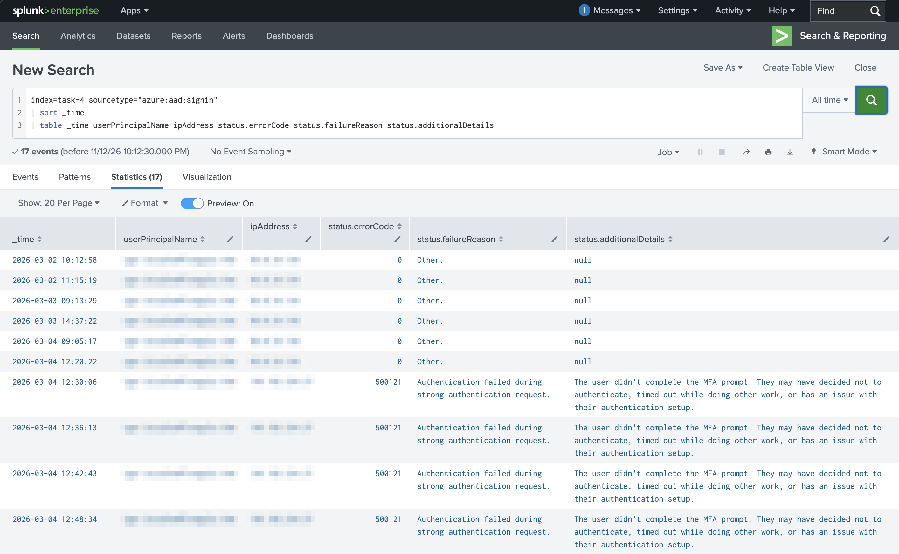
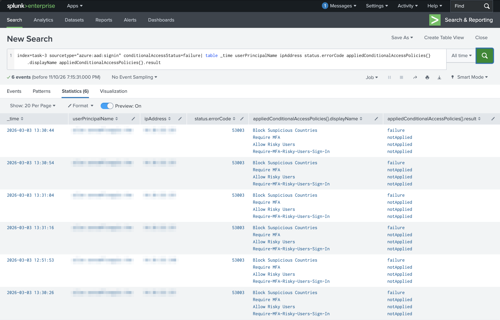
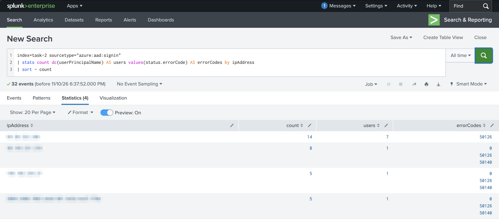
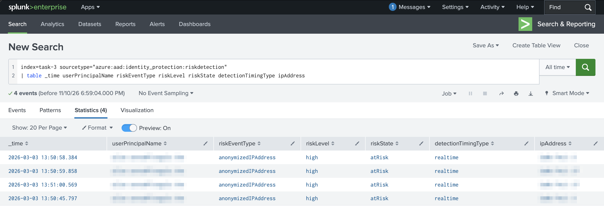
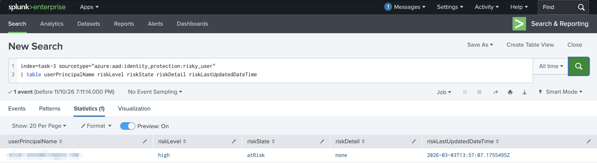

# 2. Capabilities of Microsoft Entra (25–30%)

[← Back to README](README.md)

Main lab: TryHackMe *Entra ID Monitoring*. Optional: an E5 trial tenant for portal screenshots.

---

### 2.1 Identity types

**Concept**
- **Users**: members (employees) and guests (B2B external users).
- **Workload identities**: service principals and managed identities, used by apps instead of people.
- **Devices**: Entra registered, Entra joined, or hybrid joined.
- **Agent identities** (added in the July 2026 objectives): identities for AI agents, managed like other identities.
- **Groups**: security groups and Microsoft 365 groups. Membership can be assigned or dynamic.
- **Hybrid identity**: Entra Connect / Cloud Sync syncs on-premises AD to Entra ID.

**Exam trap** — A **managed identity** is managed by Azure, so there are no credentials to store. A **service principal** is an app's identity, and you manage its secrets.

---

### 2.2 Authentication methods

**Concept**
- **MFA**: two or more of something you know, have, or are.
- **Passwordless**: Windows Hello for Business, FIDO2 keys and passkeys, Microsoft Authenticator.
- **SSPR**: self-service password reset.
- **Password protection**: blocks weak and banned passwords, including on-premises.
- **Security defaults**: free baseline MFA for everyone. Turn them off when you use Conditional Access.

**Lab** — Checked whether sign-ins in the room's tenant were single-factor or multi-factor.

**Query**

```kql
SigninLogs
| where TimeGenerated > ago(7d)
| summarize SignIns = count() by AuthenticationRequirement
```

**Result**



**Why it works** — `AuthenticationRequirement` shows `singleFactorAuthentication` or `multiFactorAuthentication`. `summarize count() by` works like `stats count by` in SPL.

**Exam trap** — SMS and voice calls are the **weakest** MFA methods. Microsoft recommends Authenticator, FIDO2 or Windows Hello.

---

### 2.3 Conditional Access

**Concept** — "If this, then that" policies. **Signals** (user or group, location, device, app, sign-in risk) lead to a **decision** (block, grant, or grant with conditions such as requiring MFA or a compliant device).

**Lab (E5 trial, optional)** — Built a policy requiring MFA for all admin roles, first in report-only mode.

**Result**



**Exam trap** — Conditional Access runs **after** first-factor authentication. It needs **Entra ID P1**.

---

### 2.4 Roles

**Concept** — **Entra roles** (e.g. Global Administrator, User Administrator) manage Entra and Microsoft 365. **Azure RBAC roles** (Owner, Contributor, Reader) manage Azure resources.

**Exam trap** — These are two separate systems. Global Admin does **not** automatically get access to Azure resources.

---

### 2.5 Identity protection: detecting attacks

**Concept** — **Entra ID Protection** scores **user risk** (account probably compromised, e.g. leaked credentials) and **sign-in risk** (this sign-in looks suspicious, e.g. impossible travel or an anonymous IP), then applies risk-based policies.

**Lab** — TryHackMe *Entra ID Monitoring* (Task 2): grouped sign-ins by source IP to tell a password spray apart from normal failed logins.

**Query** (SPL, as run in the lab)

```spl
index=task-2 sourcetype="azure:aad:signin"
| stats count dc(userPrincipalName) AS users values(status.errorCode) AS errorCodes by ipAddress
| sort - count
```

**KQL equivalent** (Microsoft Sentinel)

```kql
SigninLogs
| summarize Attempts = count(), Users = dcount(UserPrincipalName), ErrorCodes = make_set(ResultType) by IPAddress
| sort by Attempts desc
```

**Result**



*IP addresses redacted.*

**Why it works** — `dc()` (`dcount()` in KQL) counts distinct accounts per IP. The top IP tried 7 different accounts in 14 attempts, and every attempt failed with 50126 (invalid username or password). A few tries per account across many accounts is a **password spray**: it stays under lockout limits. The other IPs each belong to one user with a normal mix: a typo (50126), the "stay signed in?" prompt (50140), then success (0).

**What stops it** — Entra password protection (bans common passwords), MFA, Smart Lockout, and ID Protection's password spray detection.

**Lab B** — TryHackMe *Entra ID Monitoring* (Task 3): reviewed what Entra ID Protection flagged during the attack.

**Query** (SPL, as run in the lab)

```spl
index=task-3 sourcetype="azure:aad:identity_protection:riskdetection"
| table _time userPrincipalName riskEventType riskLevel riskState detectionTimingType ipAddress
```

**KQL equivalent** (Microsoft Sentinel)

```kql
AADUserRiskEvents
| project TimeGenerated, UserPrincipalName, RiskEventType, RiskLevel, RiskState, DetectionTimingType, IpAddress
```

**Result**



*User and IP addresses redacted.*

**Why it works** — ID Protection raised four **anonymizedIPAddress** detections: sign-ins from an anonymous network such as Tor or an anonymizing VPN. Each is **high** risk, still **atRisk** (no one has fixed or dismissed it yet) and detected in **realtime**, during the sign-in itself. That makes them **sign-in risk** detections, which a risk-based Conditional Access policy can act on straight away, for example by requiring MFA or blocking. The room's separate `risky_user` data is the **user risk** side: the overall chance that the account itself is compromised.

**Lab C** — TryHackMe *Entra ID Monitoring* (Task 3): checked the overall risk on the account itself.

**Query** (SPL, as run in the lab)

```spl
index=task-3 sourcetype="azure:aad:identity_protection:risky_user"
| table userPrincipalName riskLevel riskState riskDetail riskLastUpdatedDateTime
```

**KQL equivalent** (Microsoft Sentinel)

```kql
AADRiskyUsers
| project UserPrincipalName, RiskLevel, RiskState, RiskDetail, RiskLastUpdatedDateTime
```

**Result**



*User redacted.*

**Why it works** — This is **user risk**: one row per account, not per sign-in. The four high-risk sign-in detections in Lab B rolled up into a **high** user risk, last updated a few minutes after them. `riskState = atRisk` with `riskDetail = none` means nobody has fixed it yet. An admin could dismiss it or confirm it compromised, or the user could clear it with a secure password change.

**What stops it** — A sign-in risk policy (high risk → block or require MFA) and a user risk policy (high risk → require a secure password change). Both need Entra ID P2.

**Exam trap** — Know user risk vs sign-in risk. ID Protection needs **Entra ID P2**.

---

### 2.6 Governance

**Concept**
- **PIM**: just-in-time, time-limited, approval-based admin roles.
- **Access reviews**: regular checks that people still need their access.
- **Entitlement management**: access packages that bundle groups, apps and SharePoint sites.
- **Lifecycle workflows**: joiner, mover and leaver automation.

**Lab** — Looked for risky or suspicious app consents and role changes in audit logs.

**Query**

```kql
AuditLogs
| where TimeGenerated > ago(7d)
| where OperationName in ("Add member to role", "Consent to application")
| project TimeGenerated, OperationName, InitiatedBy, TargetResources
```

**Result**


**Exam trap** — PIM, access reviews and entitlement management need **P2** (or Entra ID Governance).

---

### 2.7 Global Secure Access

**Concept** — Microsoft's Security Service Edge: **Entra Internet Access** (secures internet and SaaS traffic) and **Entra Private Access** (a VPN replacement for internal apps), both driven by identity.

**Exam trap** — Private Access = internal apps. Internet Access = the public internet and SaaS.

---

## Licensing summary

| Feature | Free | P1 | P2 |
| --- | --- | --- | --- |
| Security defaults, basic MFA | ✓ | ✓ | ✓ |
| Conditional Access | | ✓ | ✓ |
| Hybrid identity, SSPR with writeback | | ✓ | ✓ |
| ID Protection (risk policies) | | | ✓ |
| PIM, access reviews | | | ✓ |

## Self-check

- [ ] I can explain managed identity vs service principal
- [ ] I can explain the signals and decisions in Conditional Access
- [ ] I can tell Entra roles apart from Azure RBAC roles
- [ ] I can explain user risk vs sign-in risk
- [ ] I know which features need P1 and which need P2
