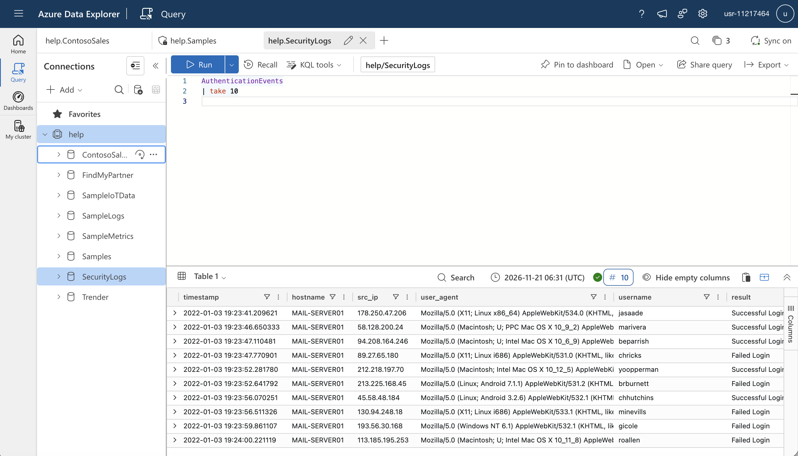
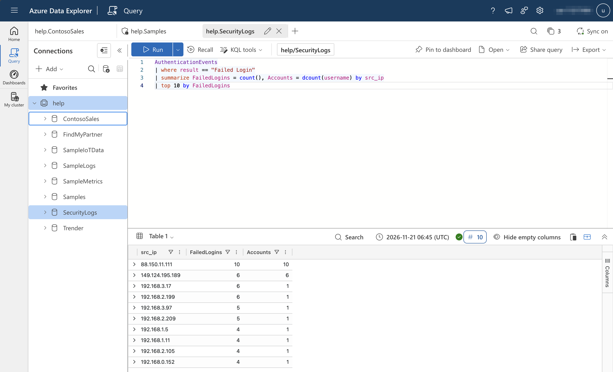

# 3. Capabilities of Microsoft Security Solutions (largest domain)

[← Back to README](README.md)

Labs: TryHackMe KQL module (Sentinel) and *XDR: Introduction* (Defender XDR). Azure infrastructure and Defender for Cloud come from Microsoft Learn.

---

### 3.1 Azure infrastructure security

**Concept**

| Service | What it does |
| --- | --- |
| Network security group (NSG) | Allow/deny rules on a subnet or network interface (IP, port, protocol) |
| Azure Firewall | Managed, stateful firewall for whole virtual networks, with threat intelligence |
| Azure DDoS Protection | Protects against flooding attacks |
| Azure Bastion | RDP/SSH to VMs through the browser, with no public IP |
| Web Application Firewall (WAF) | Protects web apps from attacks like SQL injection and XSS |
| Azure Key Vault | Stores secrets, keys and certificates |

**Exam trap** — An NSG filters traffic for a subnet or NIC. Azure Firewall protects across virtual networks. Bastion means you **don't need a public IP** on the VM.

---

### 3.2 Microsoft Defender for Cloud

**Concept** — **CSPM** (cloud security posture management) plus **CWPP** (cloud workload protection). It gives a **Secure Score**, recommendations, and threat alerts for Azure, AWS, GCP and on-premises.

**Lab** — Microsoft Learn exercise: reviewed Secure Score and the top recommendations.

**Result**


**Exam trap** — Defender for Cloud covers **multicloud**, not just Azure. Its Secure Score is different from the Microsoft Secure Score in the Defender portal for Microsoft 365.

---

### 3.3 Microsoft Sentinel

**Concept** — A cloud-native **SIEM** (collects and analyses logs) and **SOAR** (automates response). Data lives in a Log Analytics workspace and is queried with KQL. Its parts are data connectors, analytics rules, incidents, workbooks, hunting and playbooks (built on Logic Apps). Sentinel is now built into the Defender portal.

**Lab environment** — The TryHackMe *KQL (Kusto): Introduction* room uses Microsoft's demo Log Analytics workspace, which no longer holds security data. So these labs use the free **Azure Data Explorer help cluster** ([dataexplorer.azure.com/clusters/help](https://dataexplorer.azure.com/clusters/help)), database **SecurityLogs**. It runs the same KQL engine that Sentinel and Log Analytics use.

**Lab A: how the data is organised**

Data in Sentinel and Log Analytics lives in **tables** inside a **workspace** (in Data Explorer, a **database**). Each table holds one kind of event, and every KQL query starts by naming a table.

```kql
.show tables          // list the tables in the database

AuthenticationEvents
| take 10             // a sample of rows, to see the columns
```



**Why it works** — `take 10` is the KQL version of `head 10` in SPL. It shows a table's columns before you write a real query. Here `AuthenticationEvents` has `timestamp`, `hostname`, `src_ip`, `user_agent`, `username` and `result` (Successful Login / Failed Login).

**Lab B: failed logins by source IP**

```kql
AuthenticationEvents
| where result == "Failed Login"
| summarize FailedLogins = count(), Accounts = dcount(username) by src_ip
| top 10 by FailedLogins
```

**SPL equivalent** — `index=... result="Failed Login" | stats count AS FailedLogins dc(username) AS Accounts by src_ip | sort - FailedLogins | head 10`



**Why it works** — `where` filters rows, `summarize ... by` groups them (like `stats ... by`), `dcount()` counts distinct accounts (like `dc()`), and `top 10 by` sorts and limits in one step. Many accounts failing from one IP is the same password spray pattern as Lab 2.5, found here in KQL instead of SPL.

**In real Sentinel**, the Windows version of this query uses the `SecurityEvent` table and Event ID **4625** (failed logon):

```kql
SecurityEvent
| where TimeGenerated > ago(1d)
| where EventID == 4625
| summarize FailedLogons = count() by Account, Computer
| top 10 by FailedLogons
```

**Exam trap** — SIEM = **collect and detect**. SOAR = **automate the response** (playbooks). Sentinel does both.

---

### 3.4 Microsoft Defender XDR

**Concept** — Extended detection and response. It links alerts from every Defender product into one **incident**.

| Product | Protects |
| --- | --- |
| Defender for Endpoint | Devices (EDR, attack surface reduction) |
| Defender for Office 365 | Email and collaboration: phishing, Safe Links, Safe Attachments |
| Defender for Identity | On-premises Active Directory (uses domain controller signals) |
| Defender for Cloud Apps | SaaS apps (CASB, shadow IT discovery) |
| Defender Vulnerability Management | Weaknesses and missing patches across devices |
| Microsoft Defender Threat Intelligence | Threat actor and indicator information |

**Lab** — TryHackMe *XDR: Introduction*: investigated an incident and hunted for encoded PowerShell.

**Query** (advanced hunting)

```kql
DeviceProcessEvents
| where Timestamp > ago(7d)
| where FileName =~ "powershell.exe"
| where ProcessCommandLine has "-enc"
| project Timestamp, DeviceName, AccountName, ProcessCommandLine
```

**Result**


**Why it works** — Attackers often hide commands with `-enc` (Base64). `=~` is a case-insensitive equals and `has` matches a whole term. Defender tables use `Timestamp`, while Sentinel tables use `TimeGenerated`.

**Exam trap** — Defender for **Identity** = on-premises AD. **Entra ID Protection** = cloud identity. Defender for **Cloud Apps** = SaaS. Defender for **Cloud** = Azure, AWS and GCP workloads.

---

### 3.5 Security Copilot and Exposure Management

**Concept** — **Security Copilot** is the generative AI assistant: it summarises incidents, explains scripts and writes KQL from plain English. **Microsoft Security Exposure Management** shows your attack surface and possible attack paths.

**Exam trap** — Copilot *helps* analysts. It doesn't replace detections or automatically fix things.

---

## Self-check

- [ ] I can explain NSG vs Azure Firewall, and what Bastion is for
- [ ] I can explain CSPM vs CWPP in Defender for Cloud
- [ ] I can explain SIEM vs SOAR, and which Sentinel parts do each
- [ ] I can match each Defender product to what it protects
- [ ] I can write a basic KQL query with `where`, `summarize` and `project`
