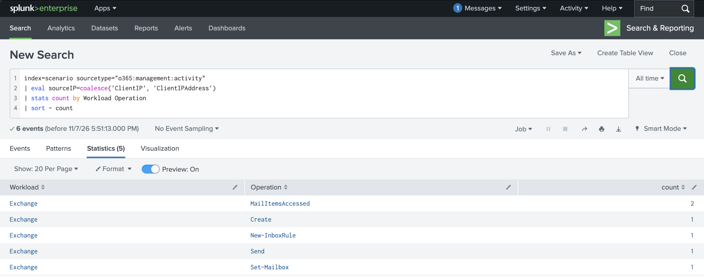

# 4. Capabilities of Microsoft Compliance Solutions

[← Back to README](README.md)

Everything in this domain lives in **Microsoft Purview**. TryHackMe doesn't cover Purview, so labs use
Microsoft Learn exercises or an E5 trial tenant. The audit lab can also be done with KQL in Sentinel.

---

### 4.1 Trust and privacy

**Concept**
- **Service Trust Portal**: Microsoft's audit reports, certifications and compliance documents.
- **Microsoft's privacy principles**: control, transparency, security, strong legal protections, no content-based targeting, benefits to you.
- **Microsoft Priva**: privacy tools (Privacy Risk Management, Subject Rights Requests).

**Exam trap** — The Service Trust Portal is about **Microsoft's** compliance. Compliance Manager is about **yours**.

---

### 4.2 Compliance Manager

**Concept** — Tracks your progress against regulations (GDPR, ISO 27001, NIST, and others) using assessments. It gives a **compliance score** and improvement actions, split into **Microsoft-managed** and **customer-managed** actions.

**Lab** — Reviewed the default Data Protection Baseline assessment.

**Result**


**Exam trap** — The compliance score measures progress on improvement actions. It does **not** certify you as compliant.

---

### 4.3 Data classification

**Concept**
- **Sensitive information types**: patterns such as credit card or passport numbers.
- **Trainable classifiers**: machine learning that recognises types of content, like contracts or CVs.
- **Content Explorer**: where sensitive data is. **Activity Explorer**: what people are doing with it.

**Exam trap** — Sensitive information types use **patterns**. Trainable classifiers use **examples** (machine learning).

---

### 4.4 Sensitivity labels and DLP

**Concept**
- **Sensitivity labels** (e.g. Public, Confidential) travel with the file. They can encrypt, watermark, and add headers and footers.
- **Data Loss Prevention (DLP)** policies detect sensitive data and block or warn when it's shared outside the rules, across Exchange, SharePoint, OneDrive, Teams, endpoints and Copilot.

**Lab** — Created a Confidential label and a DLP policy that detects credit card numbers.

**Result**


**Exam trap** — Sensitivity labels = **protect** content. Retention labels = **keep or delete** content. A file can have one of each.

---

### 4.5 Data lifecycle and records management

**Concept** — **Retention policies** apply to whole locations. **Retention labels** apply to individual items. **Records management** marks items as records that can't be edited or deleted.

**Exam trap** — Only **one** retention label can apply to an item at a time.

---

### 4.6 Insider Risk, Communication Compliance and eDiscovery

**Concept**
- **Insider Risk Management**: spots risky behaviour, such as a departing employee downloading large numbers of files. Names are pseudonymised by default.
- **Communication Compliance**: finds inappropriate or policy-breaking messages.
- **eDiscovery** (Standard and Premium): find, hold and export content for legal cases.
- **Data Security Posture Management for AI**: tracks how sensitive data is used with Copilot and other AI apps.

**Exam trap** — Insider Risk = **behaviour** (actions). Communication Compliance = **message content**.

---

### 4.7 Audit

**Concept** — **Audit (Standard)** records user and admin activity across Microsoft 365. **Audit (Premium)** adds longer retention and extra events such as `MailItemsAccessed`.

**Lab** — TryHackMe *M365 Monitoring Basics* (Task 7, Unified Audit Log): summarised every Microsoft 365 action in the lab by service and operation.

**Query** (SPL, as run in the lab)

```spl
index=scenario sourcetype="o365:management:activity"
| eval sourceIP=coalesce('ClientIP', 'ClientIPAddress')
| stats count by Workload Operation
| sort - count
```

**KQL equivalent** (Microsoft Sentinel, Office 365 connector)

```kql
OfficeActivity
| summarize count() by OfficeWorkload, Operation
| sort by count_ desc
```

**Result**



**Why it works** — The Unified Audit Log records actions across Exchange, SharePoint, OneDrive and Teams, and `stats count by` gives a quick overview of what happened. Every action here is in Exchange. `MailItemsAccessed` shows mail being read, which is an Audit (Premium) event. `New-InboxRule` and `Set-Mailbox` are common attacker moves after a compromise: they hide or forward mail. (The `sourceIP` line is only useful if you add it to the `stats`, for example `by Workload Operation sourceIP`.)

**Exam trap** — `MailItemsAccessed` (used to investigate mailbox breaches) comes with **Audit (Premium)**.

---

## Self-check

- [ ] I can explain Service Trust Portal vs Compliance Manager
- [ ] I can explain sensitivity labels vs retention labels
- [ ] I can explain sensitive information types vs trainable classifiers
- [ ] I can explain the purpose of DLP, Insider Risk, Communication Compliance and eDiscovery
- [ ] I know what Audit (Premium) adds
